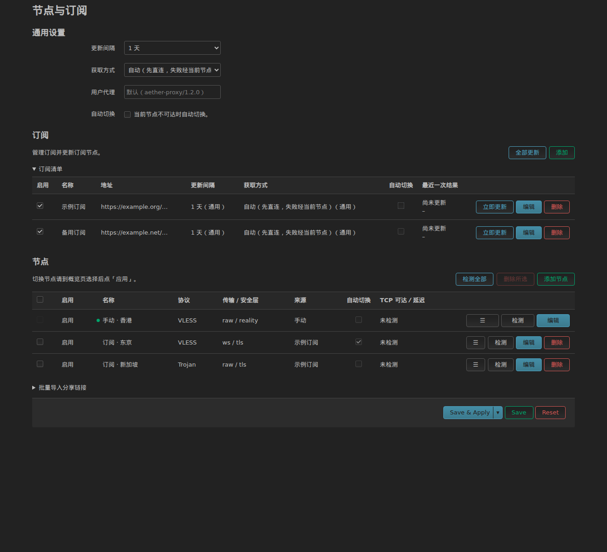
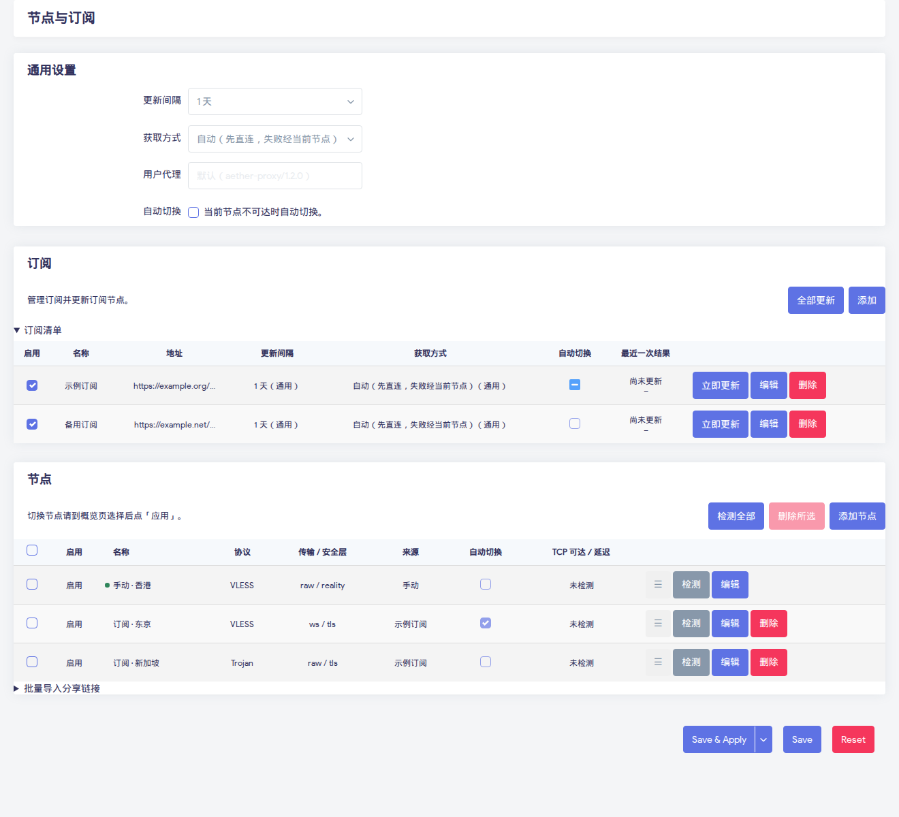

# T16.23 — 节点与订阅页块内自洽

工作树：`/workspace/openwrt/aether-proxy-wt/T16.23`；分支 `feat/t16.23-block-consistency`；基线 `b914e2e`。

- 通用设置、订阅、节点统一由 `ap.section()` 渲染。订阅和节点的标题各占一行；说明与右侧工具同排，窄屏可换行。订阅仅折叠清单（含原生空状态），标题和工具仍留在同一块内。节点的批量导入仍在节点块内，两处折叠状态独立保留。
- 节点首列 `_select` 与多选删除链路未改；移除 `_current` 和 `In use` 翻译。只有当前节点在名称左侧的独立标记位显示绿点，所有名称与「名称」表头共用左对齐线。开启减少动态效果时绿点不呼吸。节点「启用」列只读展示已有 `disabled` 状态，不新增停用操作。
- 名单按 T16.22 语义编辑。节点复选框修改单个 ID；订阅未勾选或半选时全选、已勾选时确认后全移除。拒绝或超限时还原为草稿状态。关闭总开关不清名单、控件淡显仍可编辑；风险和未生效提示只进 `title`。通用设置仍为 `form.Flag`，短说明紧跟复选框右侧；名单仍随页脚保存并应用。
- 未修改后端、schema、事件、版本、Makefile 或高级页。

## DOM 片段

省略 LuCI 自动生成的表单结构和无关属性；半选通过 DOM 属性设置，不是 HTML attribute。

```html
<div class="cbi-section">
  <h3>通用设置</h3>
  <!-- NamedSection('sub', 'sub') 的自动切换表单控件与短说明 -->
  <div class="aether-failover-setting">
    <!-- form.Flag checkbox -->
    <span>当前节点不可达时自动切换。</span>
  </div>
</div>
<div class="cbi-section">
  <h3>订阅</h3>
  <div class="aether-section-toolbar">
    <div class="cbi-map-descr">管理订阅并更新订阅节点。</div>
    <div class="aether-section-actions">…全部更新 / 添加…</div>
  </div>
  <details class="aether-subscription-list" open>
    <summary>订阅清单</summary>
    <!-- 表格，以下为自动切换单元格内的元素 -->
    <input type="checkbox" aria-label="自动切换" title="半选 · 1/2 — 总开关未开启，当前不生效">
  </details>
</div>
<div class="cbi-section">
  <h3>节点</h3>
  <div class="aether-section-toolbar">
    <div class="cbi-map-descr">切换节点请到概览页选择后点「应用」。</div>
    <div class="aether-section-actions">…检测全部 / 删除所选 / 添加节点…</div>
  </div>
  <!-- 表格：仅当前节点的名称单元格带绿点 -->
  <span class="aether-node-name">
    <span class="aether-node-current" title="当前节点" aria-label="当前节点" role="img"></span>
    <span>手动 · 香港</span>
  </span>
  <details class="cbi-section"><summary>批量导入分享链接</summary>…</details>
</div>
```

## 两主题截图

使用 OpenWrt 构建产物的 LuCI SDK 与主题 CSS，Chromium 离线加载真实视图，UCI 与 RPC 输入为示例数据。截图启用了减少动态效果，以稳定展示绿点。脚本 `tests/luci/t16.23-theme-preview.js` 同时验证两个主题下的节点名称左对齐、绿点占独立标记位、总开关的短说明与复选框同行、说明和工具按钮的实际坐标、折叠后工具仍可见、重置后收起状态保留、半选 DOM 属性及原生样式、自动切换复选框与各自表头的中心坐标、原生点击从半选到全选；不依赖真机。

**Bootstrap 暗色**



**Argon 浅色（工作区 Argon Plus 构建）**



## 验证

16 套基线测试均通过。脚本入口为 `bash tests/<suite>/run.sh`，unit 使用 `tests/host/ucode tests/run.uc`，CLI 由 review 复跑。

| 套件 | 通过数 |
|---|---|
| unit／CLI／stats／status | 1440／219／全部场景／204 |
| node／daemon／monitor／reload | 192／326／801 条 PASS／231 |
| procd／sub-status／sub／job | 123／10／157／104 |
| rpcd／probe／LuCI／schedule | 460／43／1155／47 |

- LuCI i18n：`Unused msgids: 0`。`bash tests/review.sh main`：0 FAIL；`docs/` 警告为任务明确允许的 `docs/05-config.md` 和 `docs/10-cli-luci.md`。设置 `CI_TOOLS_DIR=/workspace/openwrt/ci-spike/tools`，真实 Xray 检查 26 项、0 失败。
- `git diff --check` 和 `git diff --check main...HEAD` 无输出。
- 路由器实机验证仍由设计负责人进行：检查两主题展示、悬停提示并再次确认名单保存应用行为。
