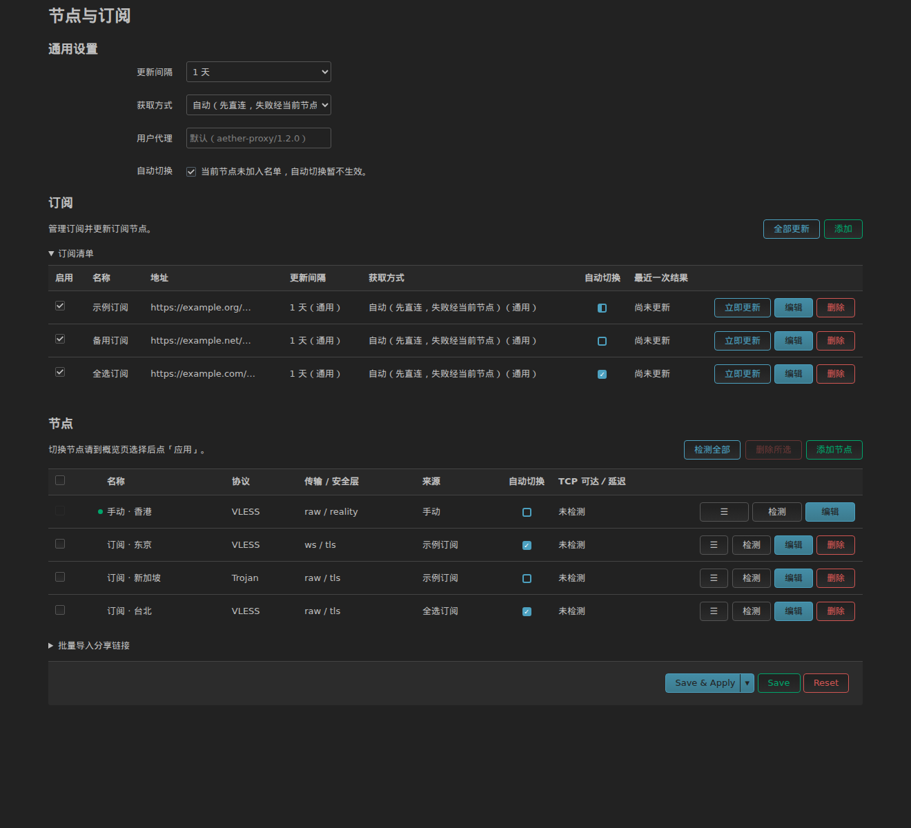
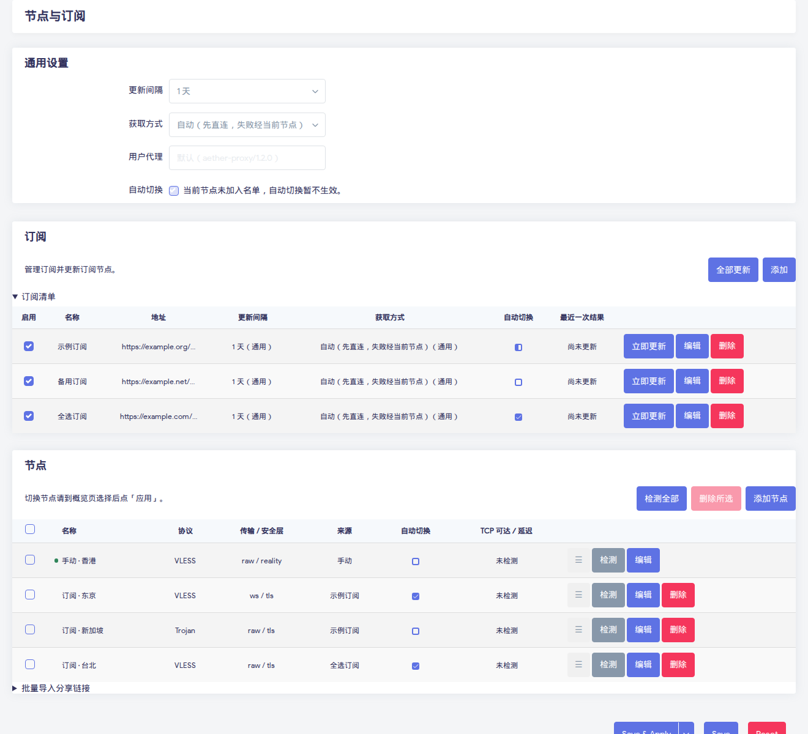

# T16.26 — 自动切换改用三态控件

工作树：`/workspace/openwrt/aether-proxy-wt/T16.26`；分支：`feat/t16.26-tri-state`；基线：`73e2ba5`。

## 实现

- 订阅表和节点表共用自绘控件；节点行仍只显示开、关两态。订阅行半选时只填充左半，不画勾；全选时才显示白勾。Bootstrap 和 Argon 分别使用自身的主题主色。
- 点击控件（含内部标记）、点击单元格空白、聚焦后按 Space 或 Enter，均进入原有 `toggle_failover`。订阅全选移除仍需确认，草稿及保存逻辑不变。总开关关闭时单元格淡显至 `0.65`，仍可编辑；保留半选计数和 T16.25 的当前节点提示。
- 总开关、订阅编辑框仍用原有 `form.Flag`；节点批量选择框也未改动。更新 `docs/10-cli-luci.md`，复用原翻译，无需修改 PO。

## 三态 DOM

下列为截图示例的订阅行，按关、开、半选列出（省略外层表格单元格）：

```html
<span class="aether-tri aether-tri--off" role="checkbox" tabindex="0" aria-checked="false" aria-label="自动切换" title="自动切换"><span class="aether-tri-mark" aria-hidden="true"></span></span>
<span class="aether-tri aether-tri--on" role="checkbox" tabindex="0" aria-checked="true" aria-label="自动切换" title="自动切换"><span class="aether-tri-mark" aria-hidden="true"></span></span>
<span class="aether-tri aether-tri--mixed" role="checkbox" tabindex="0" aria-checked="mixed" aria-label="自动切换" title="半选 · 1/2"><span class="aether-tri-mark" aria-hidden="true"></span></span>
```

只有 `.aether-tri--on` 下的标记绘制 `::after` 对勾。总开关关闭时控件追加 `.aether-tri--inactive`，由单元格应用透明度；半选提示会追加「总开关未开启，当前不生效」。

## 两主题截图

使用真实 LuCI SDK 与主题资源，UCI/RPC 数据由测试提供。订阅表「自动切换」列从上到下是半选、关、开。





复现：`NODE_PATH=<Playwright node_modules> node tests/luci/t16.23-theme-preview.js <OpenWrt 构建根目录>/www tests/luci/evidence/t16.26`。两主题 Chromium 检查均通过：绘制、列对齐、淡显、键盘焦点与 Space、单元格空白与真实标记点击。尚未在路由器真机复验。

## 验证

16 套基线全部通过。unit 入口为 `tests/host/ucode tests/run.uc`；其余为 `bash tests/<suite>/run.sh`（procd 为 `tests/stubs/procd/run.sh`）。

| 套件 | 通过数 |
| --- | --- |
| unit／CLI／stats／status | 1440／219／全部场景／204 |
| node／daemon／monitor／reload | 192／326／801 条 PASS／231 |
| procd／sub-status／sub／job | 123／10／157／104 |
| rpcd／probe／LuCI／schedule | 460／43／1160／47 |

- LuCI 回归覆盖三态 DOM、Space/Enter 与点击共用切换路径、单元格转发不重复触发、确认与取消、草稿重置、旧半选样式移除。i18n：`Unused msgids: 0`。
- `CI_TOOLS_DIR=/workspace/openwrt/ci-spike/tools bash tests/review.sh main`：`0 FAIL`；真实 Xray 26 项通过。`docs/10-cli-luci.md` 的 WARN 是任务要求的文档同步。
- `git diff --check` 和 `git diff --check main...HEAD` 均无输出。
