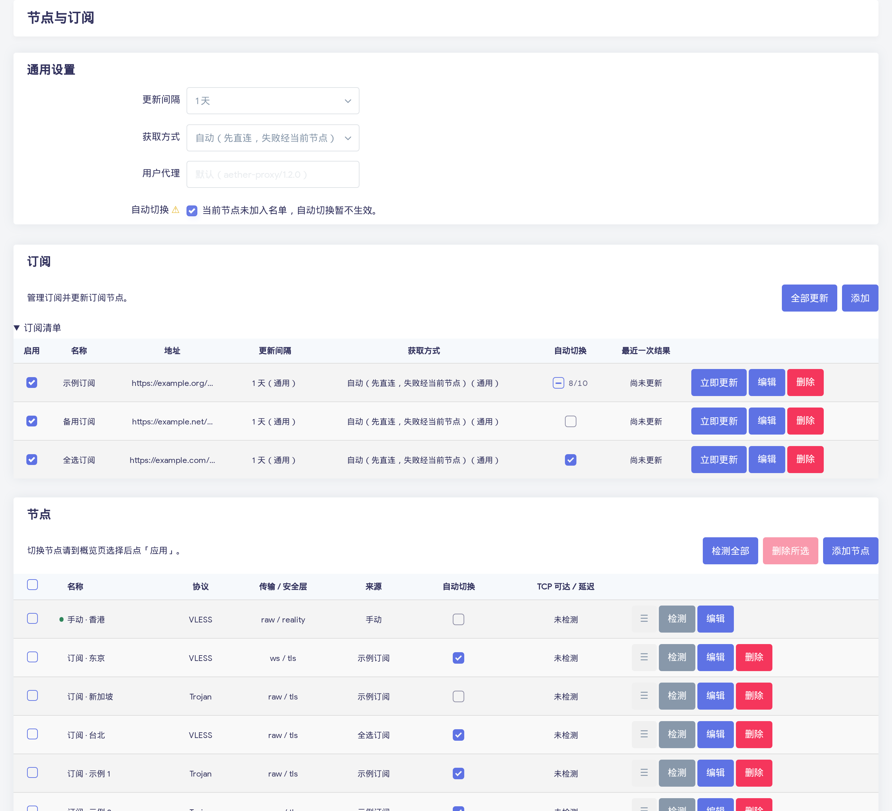
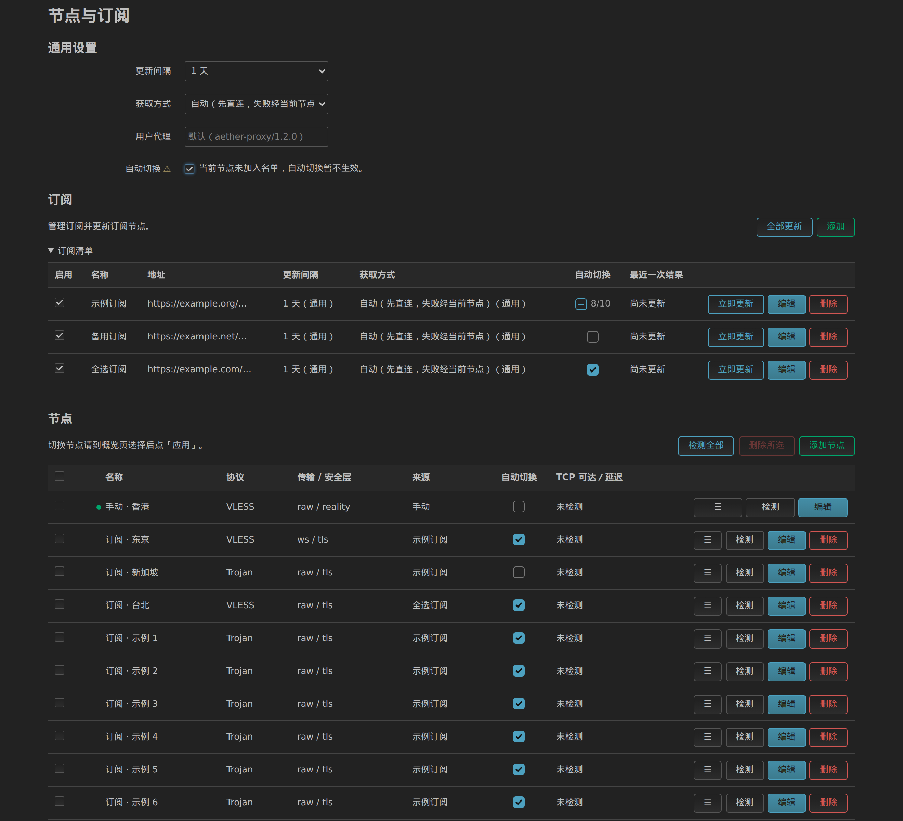

# T16.27 完成报告

## 改动

- `view/aether-proxy/overview.js` 回到 `88ab42f` 的布局；与该版相比，唯一额外差异是端口范围改用 `ap.hint_icon()`。页头启用／刷新控制移回块外，启停按钮回到状态行右侧；详情后是节点行，流量和组件也恢复本地 `section()`。
- `aether-proxy/common.js` 抽取提示图标。悬停使用原生 `title`，焦点、点击和键盘共用显隐逻辑；指针以聚焦前的状态取反，阻止标签激活。`subscriptions-block.js` 接入黄色 ⚠，`po/zh_Hans/aether-proxy.po` 补其可访问名称。
- `subscriptions-block.js` 集中挂载两表共用的 B 方案样式，`nodes.js` 仅删除旧的自动切换 CSS。切换继续走原有草稿、确认和保存路径；关总开关只淡显，不锁定编辑。
- `docs/10-cli-luci.md` 记录概览块结构例外和移动端提示交互。`tests/luci/` 更新对应 DOM 断言和离线 Chromium 验证；未改后端、schema、事件、配置语义或其他页面。

## 概览前后对比

用同一离线 LuCI SDK、主题和 RPC/UCI 样例。改前沿用 T16.24 的已存档截图。

| 主题 | 改前：T16.24 | 改后：T16.27 |
|---|---|---|
| Argon 浅色 | [页头控件在运行状态块内](../tests/luci/evidence/t16.24/overview-argon-light.png) | [页头控制回到块外，服务按钮与状态并列](../tests/luci/evidence/t16.27/overview-argon-light.png) |
| Bootstrap 深色 | [页头控件在运行状态块内](../tests/luci/evidence/t16.24/overview-bootstrap-dark.png) | [页头控制回到块外，服务按钮与状态并列](../tests/luci/evidence/t16.27/overview-bootstrap-dark.png) |

## ⚠ 气泡收起与展开

截图中总开关始终关闭；Chromium 触摸点击展开，再点收起，未激活开关。


## 双主题三态与 B 行逐项对照

订阅表从上到下为 **半选 8/10、关、开**；节点表在同一截图中展示同组件的关／开。




| B 行要素 | 实现与验证 |
|---|---|
| 方框几何 | 17×17 CSS px，4px 圆角，声明 1.5px 边线（Chromium 可按像素取整）；行内垂直居中，计数间距 0.45em。 |
| 关 | 空框、正文色边线，静止时 .55；没有勾和计数。 |
| 半选 | 保留透明背景，正中主色 9×2px 短横，1px 圆角，右侧 `8/10` 用 .75 透明度和等宽数字。定稿文字要求主色描边，优先于板图的中性半选描边。 |
| 开 | 主色填充与边线，9×5px、2px 笔画斜勾；浅底得浅勾，深底得深勾，颜色来自主题背景或 `Canvas`，不用写死黑白。 |
| 悬停／焦点／窄屏 | 悬停边线转主色；键盘主色描边、偏移 2px；减少动画时无过渡。列头预留最小宽度，360px 下切换 `8/10` → 全选时实测列宽不变，关／开不渲染计数。 |

## 场景对照

| 卡上场景 | 测试 | 判定 |
|---|---|---|
| 概览块外标题和页首控件、块标题、状态行右侧按钮、节点紧随详情 | `overview.test.js`：`T10.9 scenario 2/5`；`t16.24-theme-preview.js` 的 `overview` 场景 | 检查块内没有页头开关／刷新按钮，直接子元素为 `h3`；断言状态行右侧子元素包含启停按钮、节点行紧随详情，浏览器比对按钮与状态的横坐标。 |
| 轮询不重建控件 | `overview.test.js`：`T10.3 scenario 6d`、`T10.4 scenario 5 / T10.5` | 检查启用、选择、探测及其结果节点的对象身份不变。 |
| 黄色 ⚠ 不用主色；初始收起；聚焦／失焦；指针只切换一次；Enter/Space/Escape；不连动开关 | `progressive-lists.test.js`：`T16.27: failover risk warning shares the hint behavior without toggling the switch`；`overview.test.js`：`M4-16`；`t16.23-theme-preview.js` | 断言主题警示色和两种 fallback；检查 `hidden` 与 `aria-expanded` 同步、事件阻止默认激活和冒泡、两种总开关状态下不改变值，并在 SDK 标签中做真实触摸点击。 |
| 三态 class 和 ARIA、透明半选＋短横、仅半选有 n/m、勾取主题背景、黑白禁用和变量回退 | `progressive-lists.test.js`：`T16.22: subscription off, partial 8/10 and on; batches and confirmation are draft-only`；`t16.23-theme-preview.js` | 断言两表控件结构和三态转移；在两主题中核对计算样式、计数、焦点、悬停和窄屏列宽；无主题变量时与 `Highlight`／`Canvas` 的计算色相等。 |
| 键盘与整格点击等价，关总开关仍可点 | `progressive-lists.test.js`：`T16.26: click, Space, Enter, and cell background use the same toggle once`、`T16.22: entire node cell toggles while grey; it repaints subscription and footer reset drops changes`；`t16.23-theme-preview.js` | 直接按键、空白格和框本身分别只调用一次切换；实际 SDK 上核对 .65 淡显、键盘与整格点击。 |

## 验收与环境

视觉验证使用本机已构建的 OpenWrt LuCI SDK、Argon Plus 浅色、Bootstrap 深色和 Chromium；仅 UCI/RPC 数据由 fixture 提供。无新增下载，未在路由器真机复验。

```sh
NODE_PATH=<Playwright-node_modules> AETHER_PREVIEW_VIEW=overview \
  node tests/luci/t16.24-theme-preview.js <root/www> tests/luci/evidence/t16.27
NODE_PATH=<Playwright-node_modules> \
  node tests/luci/t16.23-theme-preview.js <root/www> tests/luci/evidence/t16.27
```
