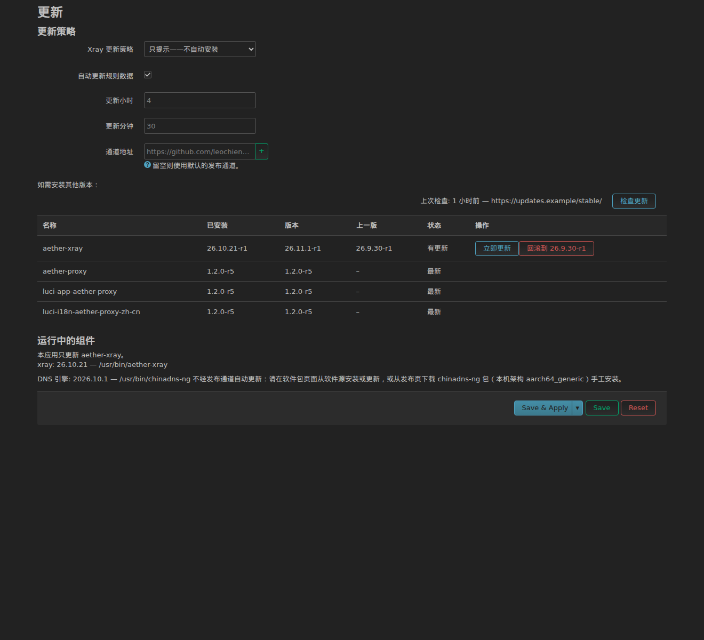
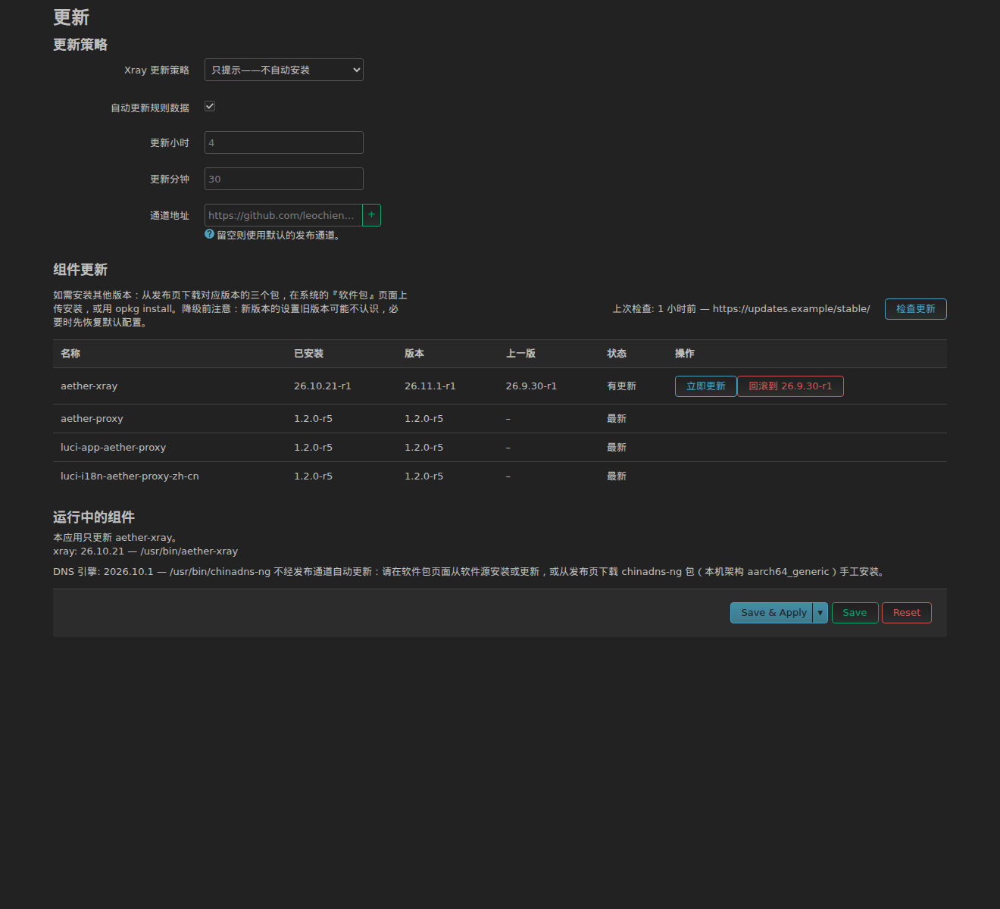
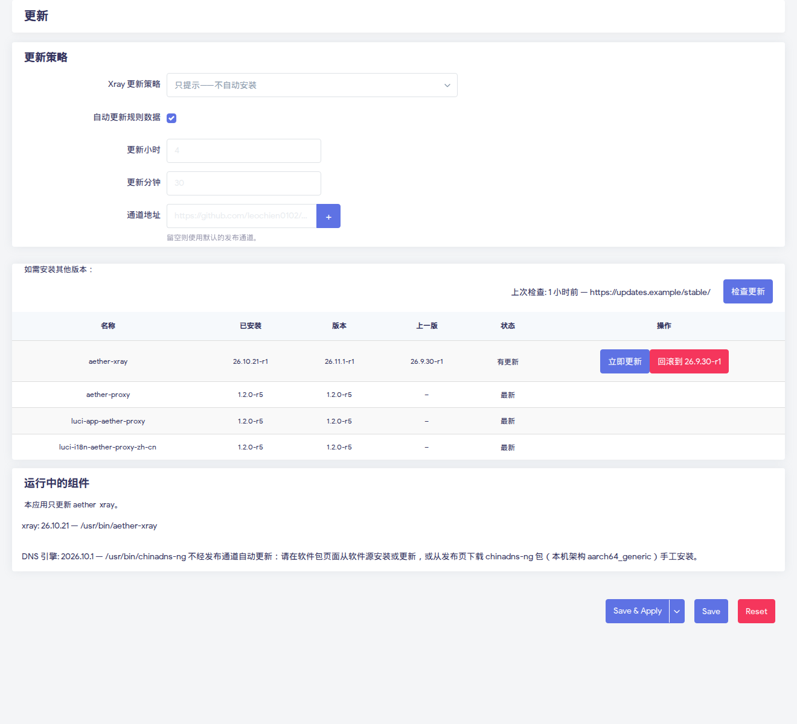
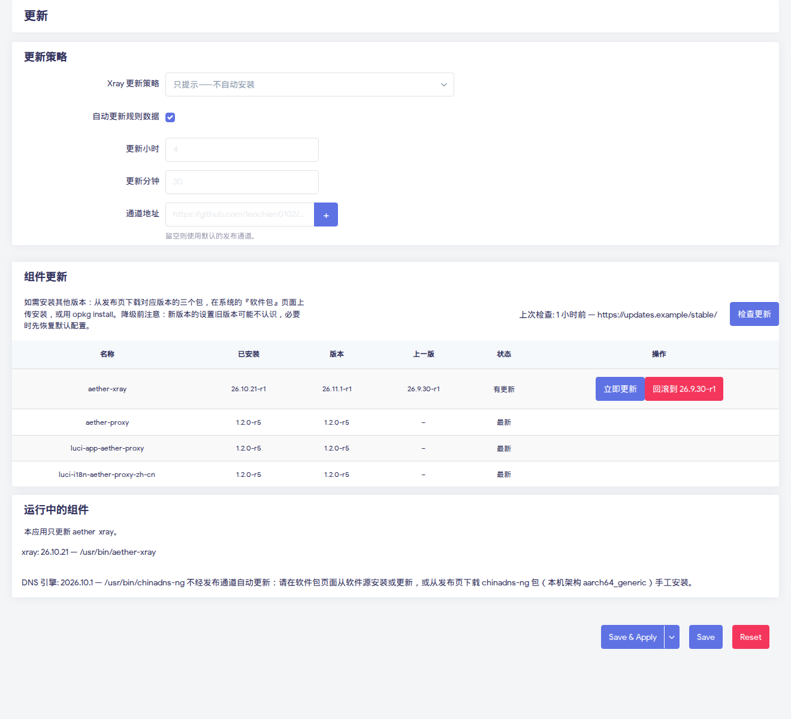
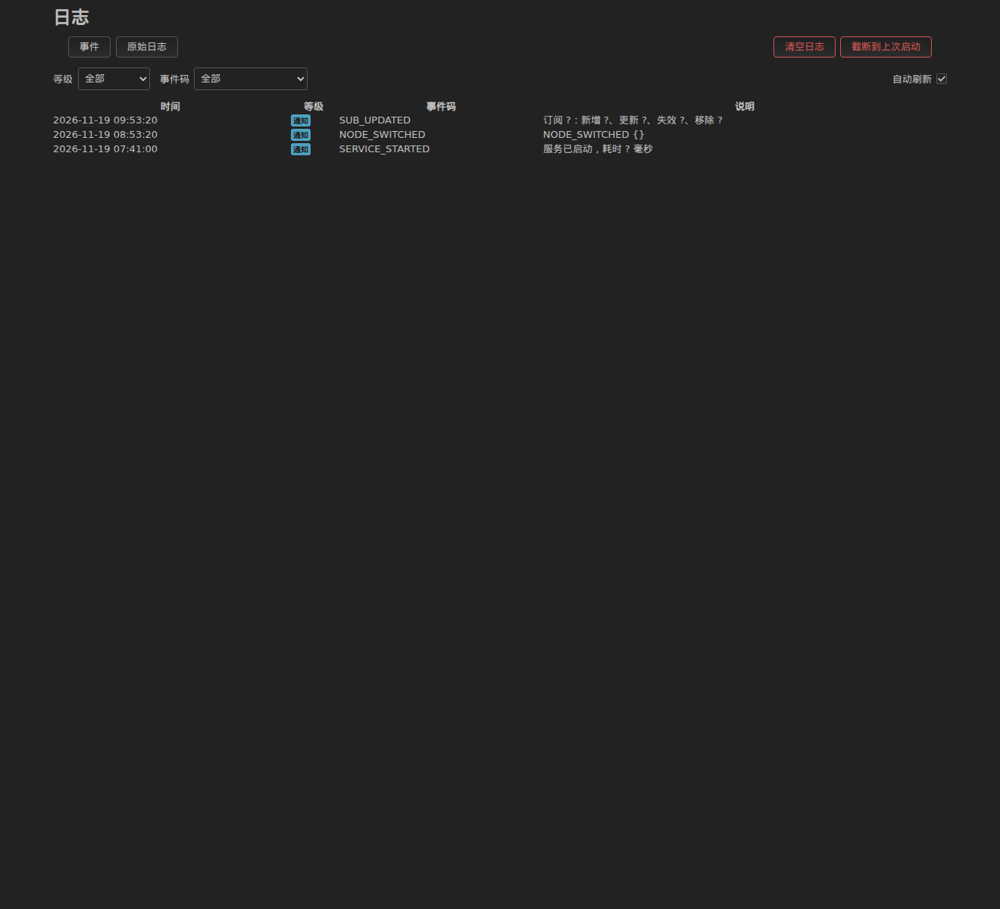
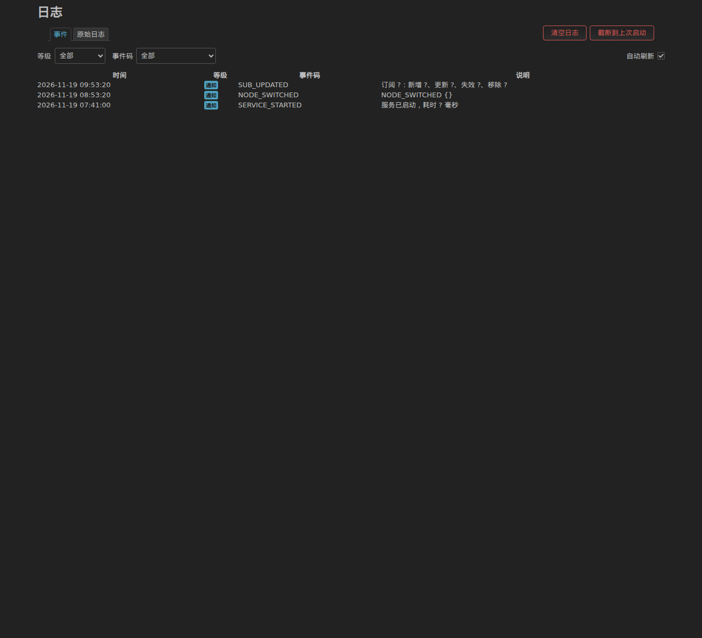
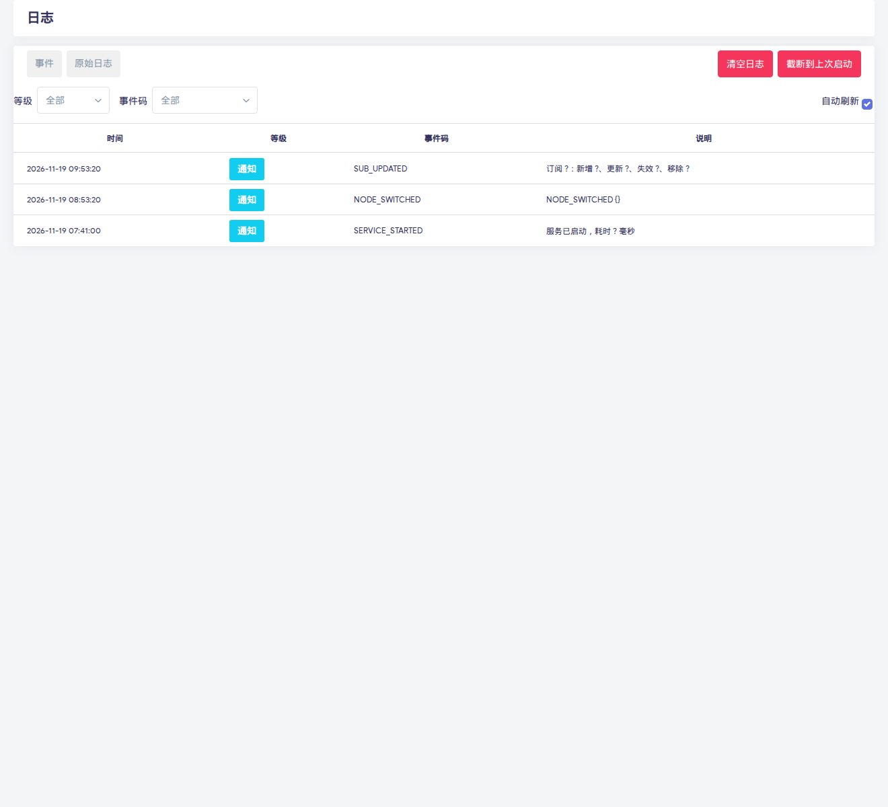
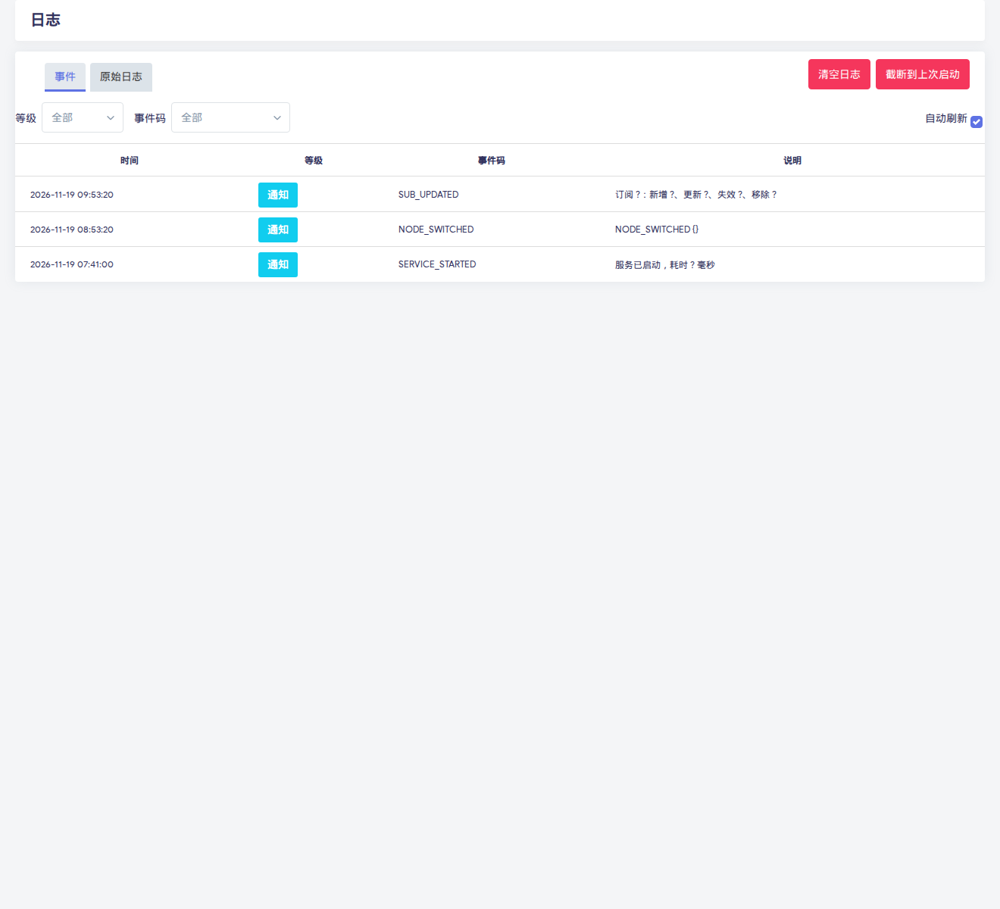

# T16.28 更新页与日志页界面修正

工作树：`/workspace/openwrt/aether-proxy-wt/T16.28`；分支：`feat/t16.28-tabs-and-notes`。对照基线为 `34805dd`；开工时分支 HEAD 为 `c23fe77`，两者仅有任务卡说明差异。

- **更新页**：「组件更新」块直接展示完整的手动安装／降级说明。说明与上次检查、反馈、进度和「检查更新」共用默认工具栏，左文右操作，窄屏换行。包表仍在块内，「运行中的组件」未改。
- **日志页**：改用 LuCI 主题的 `ul.cbi-tabmenu` 和两个可聚焦的链接；点击或按 Enter 不跳转。切换更新标签选中样式、`aria-selected` 和面板 `hidden`；工具栏和右侧动作按钮保持挂载。筛选、轮询及清空／截断逻辑未改。
- 只改目标视图、翻译、`docs/10-cli-luci.md`、LuCI 测试和证据；未改后端、事件、配置、版本或其他页面。

## 改前／改后截图

由 Chromium 加载构建产物中的真实 LuCI SDK 和 Bootstrap 深色／Argon Plus 浅色主题，使用相同的模拟 UCI/RPC 和 1320 × 1200 视口。改前使用 `34805dd` 的视图、翻译和预览脚本；改后使用任务分支。浏览器另验证两个主题均在桌面同行、360 px 时换行，以及日志页 Enter 切换、焦点保留和面板可见性。未连接路由器，真机验收待确认。

| 页面／主题 | 改前 | 改后 |
|---|---|---|
| 更新 · Bootstrap 深色 |  |  |
| 更新 · Argon Plus 浅色 |  |  |
| 日志 · Bootstrap 深色 |  |  |
| 日志 · Argon Plus 浅色 |  |  |

改后复现：设置 `NODE_PATH` 指向 Playwright 的 `node_modules`，`WWW` 指向构建产物的 `www` 目录，在工作树根目录执行：

```sh
for view in updates logs; do
  AETHER_PREVIEW_VIEW="$view" node tests/luci/t16.24-theme-preview.js \
    "$WWW" tests/luci/evidence/t16.28/after
done
```

## 返工：日志标签截断

在 rebase 到 `cbf13c0` 后的分支上，针对 Bootstrap 深色把「原始日志」显示为「原始…」的问题，给日志工具栏加 `.aether-log-toolbar` 作用域。标签条与标签不再收缩，取消 `li` 的主题宽度上限，链接不再使用省略号；工具栏仍负责整组换行。样式随日志页挂载，不修改主题、共享组件、共享测试或更新页。

重新截取上表两张日志「改后」截图；Argon Plus 浅色原本未截断，重截文件与原图字节一致。两种主题下均用 Chromium 测量文本边界：1320 px 和 360 px 时「事件」「原始日志」的完整文本都放得下；360 px 时右侧操作换到下一行，而不是压缩或省略标签。

## 验证

返工后重新运行任务指定的 16 套，**全部通过**（退出码均为 0）。

| 套件 | 结果 | 套件 | 结果 |
|---|---|---|---|
| unit | 1440 通过，0 失败，0 跳过 | procd | 123 通过，0 失败 |
| CLI | 219 通过，0 失败 | sub-status | 10 通过，0 失败 |
| stats | 全部场景通过（113 条 PASS） | sub | 157 通过，0 失败 |
| status | 204 通过，0 失败 | job | 104 通过，0 失败 |
| node | 192 通过，0 失败 | rpcd | 460 通过，0 失败 |
| daemon | 326 通过，0 失败 | probe | 43 通过，0 失败 |
| monitor | 801 条 PASS | LuCI | 1170 通过，0 失败 |
| reload | 231 通过，0 失败 | schedule | 47 通过，0 失败 |

- LuCI 翻译检查：`Unused msgids: 0`。
- 返工后重跑 `CI_TOOLS_DIR=/workspace/openwrt/ci-spike/tools bash tests/review.sh main`：**0 FAIL / 1 WARN**。缓存的 Xray 26.11.9 检查 26 项、0 失败。唯一警告为本卡要求修改的 `docs/10-cli-luci.md`。
- `git diff --check` 与 `git diff --check main...HEAD` 均无输出。未 push，未合并 `main`。
