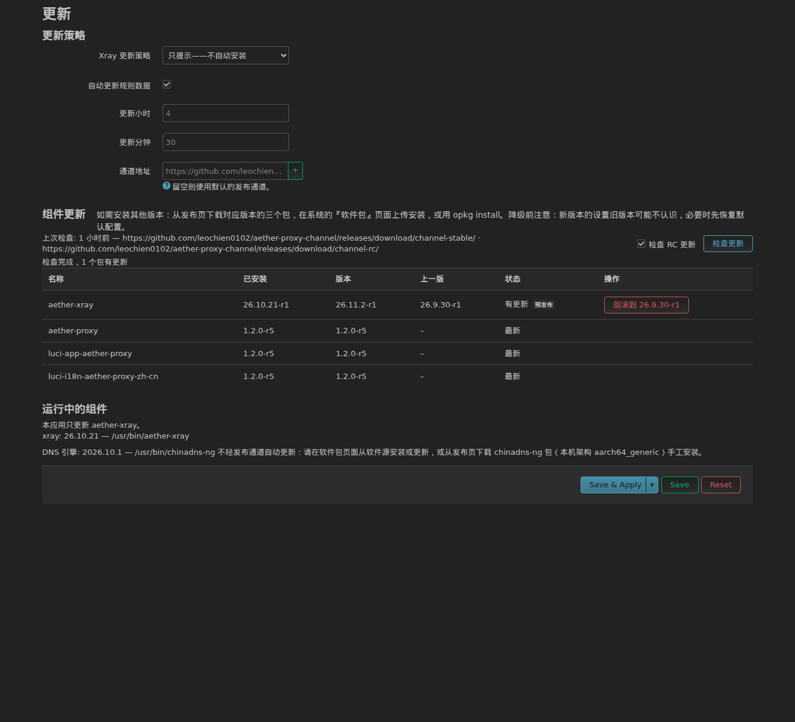
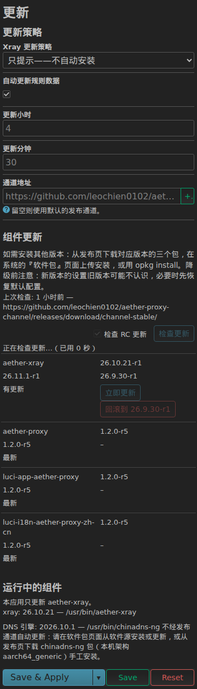
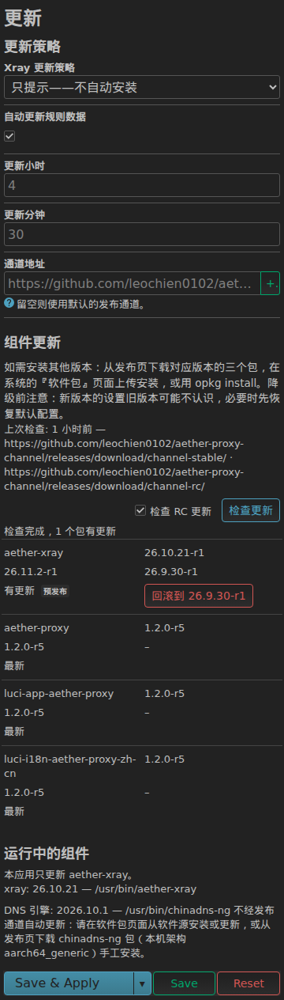
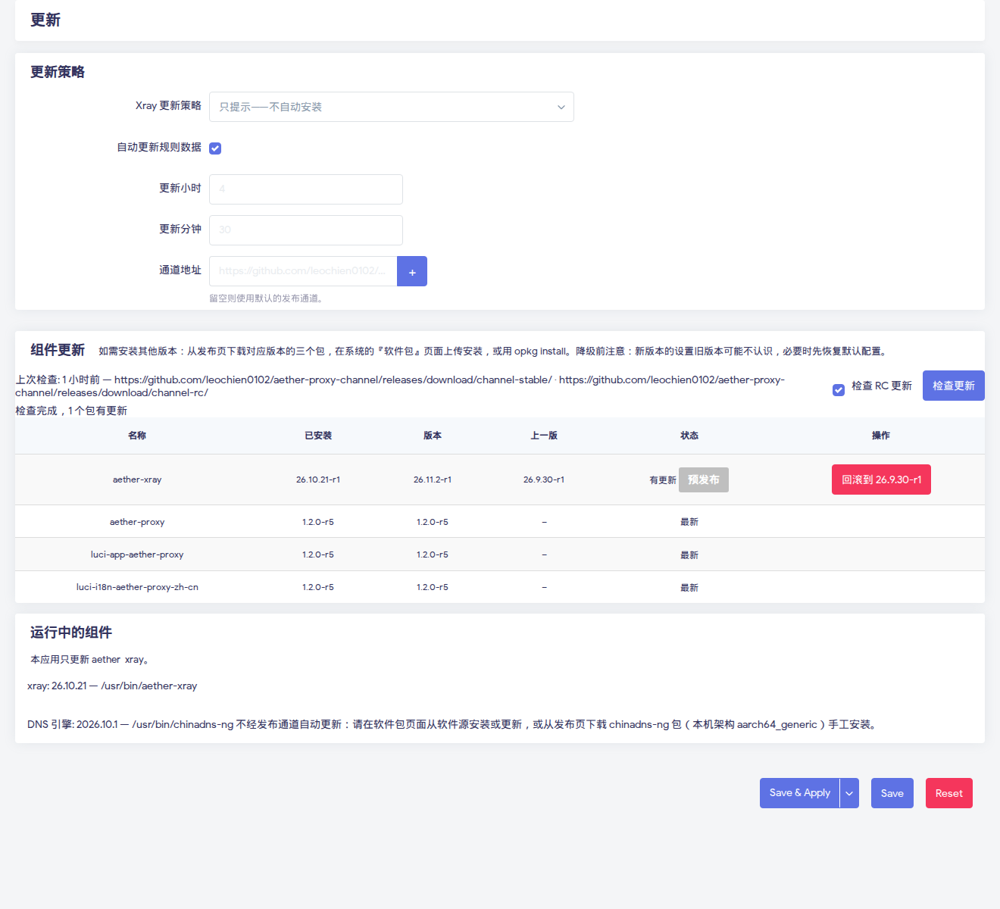
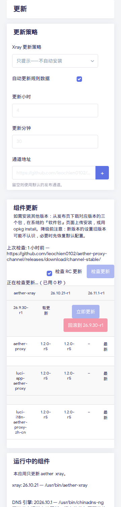
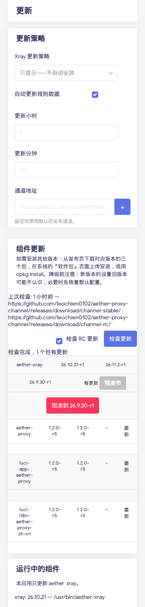

# T16.31 组件更新：RC 通道开关与块信息层级

工作树：`/workspace/openwrt/aether-proxy-wt/T16.31`；分支：`feat/t16.31-update-channel`。任务给定基线 `aa0d6fa`，开工时分支与 `main` 都是 `0e51b86`（补充并行边界的任务卡提交）；T16.30 尚未合入，无需 rebase。未改发布侧、版本比较语义、事件白名单、安装或回滚行为。

默认只查 `channel-stable`。打开「检查 RC 更新」后持久化 `main.update_channel=rc` 并立即重查；只有经过验签、带 `prerelease: true` 的 RC 清单可参与合并。RC 独有或版本更高的条目进入合并结果；同版本和更新的 stable 条目优先。`updates.json` 顶层仍是 stable，RC 合并结果使用 `release_candidates` 键。预发布结果仅用于发现与展示，不是安装目标，也不会影响自动 Xray 安装、兼容链、回滚或数据更新。`docs/05-config.md`、`docs/08-updates.md`、`docs/10-cli-luci.md` 由本卡授权同步修改。

## 断言清单

| 覆盖 | 证据 |
|---|---|
| 默认/显式 stable、非法 `update_channel` 均不访问 RC；开启会读两份清单；关闭后不再返回 RC | `tests/update/run.sh`：带真实 usign 签名的本地 HTTP 夹具，断言 RC URL 的访问计数和 CLI JSON。 |
| RC 专有项、较新 RC 的标志透传；同版 stable 资产优先、老 RC 不遮挡较新 stable；装了同版本的 RC 不再提示 | `tests/update/run.sh`：断言资产名、`available`、`newer`、`prerelease`；无签名的 RC 不替换稳定结果。 |
| stable 缓存不含 RC 覆盖，合并结果单独保存 | `tests/update/run.sh` 读取 `updates.json` 顶层和 `release_candidates`。 |
| 开关可用、应用成功后立即重查，不连带应用其他暂存配置；RC 徽标仅用于可用 RC，已安装同版本显示「最新」 | `tests/luci/updates.test.js` 的 T16.31 开关、徽标和工具行断言。 |
| 标题行包含手动安装说明；块主体顺序为状态 → 进度/结果 → 表；运行时禁用，完成时摘要替换进度，初始无空行 | `tests/luci/updates.test.js` 与真实 LuCI SDK 的 Chromium 预览；两个主题下验证说明在桌面位于标题右侧、360 px 换行，URL 和操作组均不溢出。 |
| 无未引用翻译 | `tests/luci/i18n.test.js`：`Unused msgids: 0`。 |

## 截图

Chromium + 构建产物中的真实 LuCI SDK 和主题，UCI / rpcd 用离线夹具。未连接路由器或实际 RC 发布通道。两套主题各留桌面完成、360 px 检查中、360 px 检查完成三张。

| 主题 | 桌面（1320 px） | 360 px：进行中 | 360 px：完成 |
|---|---|---|---|
| Bootstrap 深色 |  |  |  |
| Argon Plus 浅色 |  |  |  |

设置 `NODE_PATH` 指向 Playwright 的 `node_modules`，`WWW` 指向 OpenWrt 构建产物的 `www` 目录：

```sh
AETHER_T16_31=1 AETHER_PREVIEW_VIEW=updates node tests/luci/t16.24-theme-preview.js \
  "$WWW" tests/luci/evidence/t16.31
```

## 标题行调整

按后续截图反馈，手动安装和降级说明移到「组件更新」标题右侧，字号为标题的 75%，在 360 px 换到标题下方。主体不再重复说明，RC 通道说明仍可从开关提示和无障碍描述读取。上方六张截图为调整后版本；本次调整重跑 LuCI，1171 通过、0 失败、未引用翻译 0。

## 原任务回归验证

任务卡指定的 16 套（`docs/tasks/m16.md` 的 T16.1 清单）全部退出 0：

| 套件 | 通过 | 套件 | 通过 |
|---|---:|---|---:|
| unit | 1441 | procd | 123 |
| CLI | 219 | sub-status | 10 |
| stats | 113 条 PASS | sub | 157 |
| status | 204 | job | 104 |
| node | 192 | rpcd | 460 |
| daemon | 326 | probe | 43 |
| monitor | 801 条 PASS | LuCI | 1171 |
| reload | 231 | schedule | 47 |

当前 CI 的 `rules`（7）、`update`（1058）、`compat`（10）也通过；额外的 `bootstrap-startup`、`xray-ready` 通过。额外试跑的 `bootstrap-dns` 失败于 Q11 `original resolver call sites retained monitor.uc`，无本卡 diff 的本地 `main` 归档上也复现同一断言，涉及文件不在本卡白名单内。

`CI_TOOLS_DIR=/workspace/openwrt/ci-spike/tools bash tests/review.sh main`：**0 FAIL，1 WARN**；Xray 26.11.9 的 26 项全部通过。唯一警告是本卡要求修改的三份文档。`git diff --check` 和 `git diff --check main...HEAD` 均无输出。未推送，未合并 `main`。
