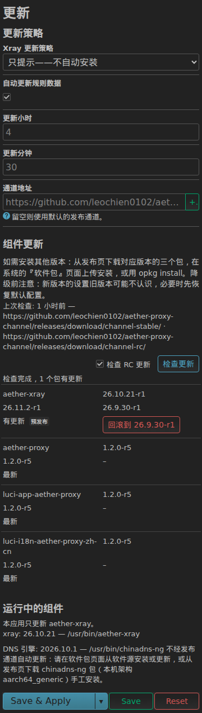
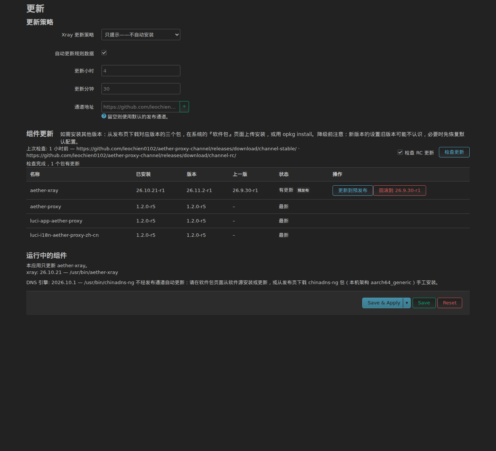
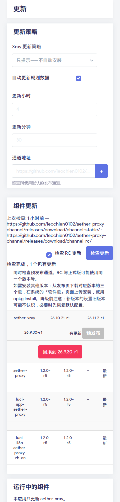
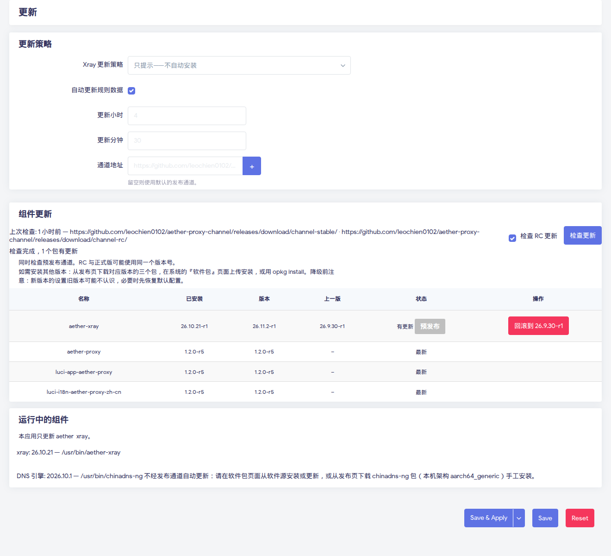

# T16.33 更新页：开关不触发检查、文案与状态行收拢

工作树：`/workspace/openwrt/aether-proxy-wt/T16.33`；分支：`feat/t16.33-update-polish`；基线：`4f2ebea`。

## 改动

- LuCI `view/aether-proxy/updates.js`：开关只保存通道偏好并重画已有结果，不派发作业、不覆盖其他未保存的表单输入。没有检查结果时仍显示「尚未检查」。时间、通道链接、进度、结果与错误共用状态行；仅在候选模式且有地址时显示「候选通道」。表格、安装和回滚流程不变。
- `po/zh_Hans/aether-proxy.po`、`docs/10-cli-luci.md`：同步「检查候选更新」、短链接及手动检查行为。
- `tests/luci/updates.test.js`、`tests/luci/t16.24-theme-preview.js`：回归断言与离线 Chromium 取证；新截图存于 `tests/luci/evidence/t16.33/`。

## 场景对照

- **拨动开关不发作业**：`tests/luci/updates.test.js` → `T16.33 switching candidate mode starts no update_check job and preserves form edits`。启用和关闭前后分别比对 `ap.run_job` 调用计数；同时验证缓存复用、UCI 重读、未保存输入和 RC 安装确认。
- 同一断言校验两个链接的 `href`、`target`、`rel`、`title`，关闭候选后不再渲染「候选通道」。`T16.33 last checked, progress, summary and errors share the status row` 验证时间、结果、进度与错误位置及 `role="status"`。另覆盖初次读取、尚未检查和偏好提交失败时恢复控件。
- Chromium 预览额外统计 `job_start`：打开候选后为 0，手动检查后为 1，关闭候选后仍为 1；360 px 下两种主题的链接均与检查时间同一视觉行，不单独占行。

## 验收

任务卡指定的 16 套全部退出 0。单测使用 `tests/host/ucode tests/run.uc`，其余均用 `bash tests/<suite>/run.sh`（procd 为 `tests/stubs/procd/run.sh`）。

| 套件 | 通过 | 套件 | 通过 |
|---|---:|---|---:|
| unit | 1441 | procd | 123 |
| cli | 232 | sub-status | 10 |
| stats | 113 条 PASS | sub | 157 |
| status | 204 | job | 104 |
| node | 192 | rpcd | 476 |
| daemon | 326 | probe | 43 |
| monitor | 801 条 PASS | luci | 1172 |
| reload | 231 | schedule | 47 |

LuCI 未引用翻译 0；`git diff --check` 与 `git diff --check main...HEAD` 无输出。

### `tests/review.sh` 输出

在干净的实现提交 `ebcf603` 上运行 `CI_TOOLS_DIR=/workspace/openwrt/ci-spike/tools bash tests/review.sh main`，退出 0。唯一警告是本卡明确要求同步 `docs/10-cli-luci.md`。首次并行运行也为 0 FAIL，但有测试夹具造成的临时工作树警告，已在 16 套结束后消除。

```text
== branch feat/t16.33-update-polish vs main: 1 commit(s), 10 file(s)
PASS  tests/run.uc: 1441 passed, 0 failed, 0 skipped
PASS  tests/cli/run.sh: 232 passed, 0 failed
PASS  tests/ci/xray.sh: xray 26.11.9: 26 checked, 0 failed
PASS  changed .uc files compile/load
PASS  no swallowed errors in added code
PASS  no system()/popen() outside sys.uc
WARN  docs/ changed (only spike cards may change docs; explain in the report)
      docs/10-cli-luci.md
PASS  no attribution trailers in commits
PASS  report present: reports/T16.33.md
== 0 FAIL, 1 WARN
```

无已知偏差或待定项，未下载工具或二进制。未推送、未合并 `main`。

## 截图

均为 Chromium 下的真实 LuCI SDK 与主题，UCI / rpcd 使用离线夹具。改前引用基线中已入库的 T16.31 截图；改前、改后均为候选模式下已完成检查。未操作真实路由器。

| 主题 / 宽度 | 改前（基线） | 改后 |
|---|---|---|
| Bootstrap 深色 / 360 px |  |  |
| Bootstrap 深色 / 1320 px |  |  |
| Argon Plus 浅色 / 360 px |  |  |
| Argon Plus 浅色 / 1320 px |  |  |

复现：设置 `NODE_PATH` 为 Playwright 的 `node_modules`，`WWW` 为包含两套主题的 OpenWrt 构建产物的 `www` 目录。

```sh
AETHER_T16_33=1 AETHER_PREVIEW_VIEW=updates node tests/luci/t16.24-theme-preview.js \
  "$WWW" tests/luci/evidence/t16.33
```
