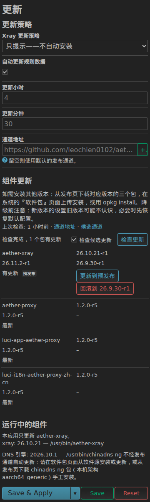
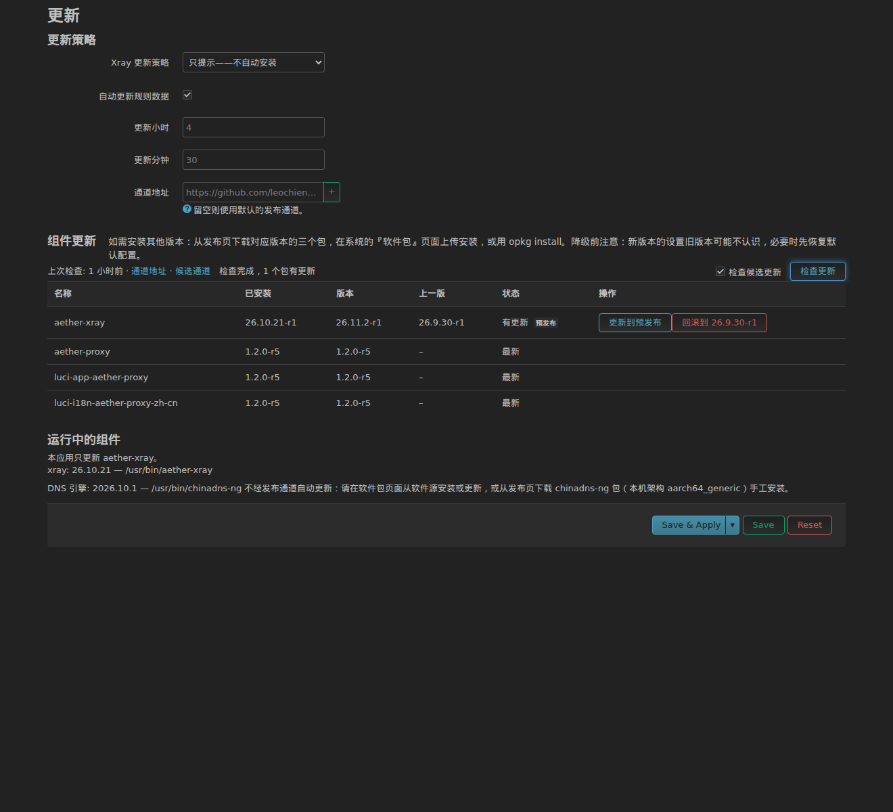
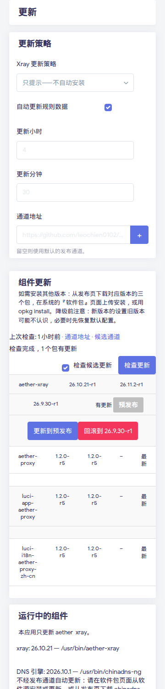
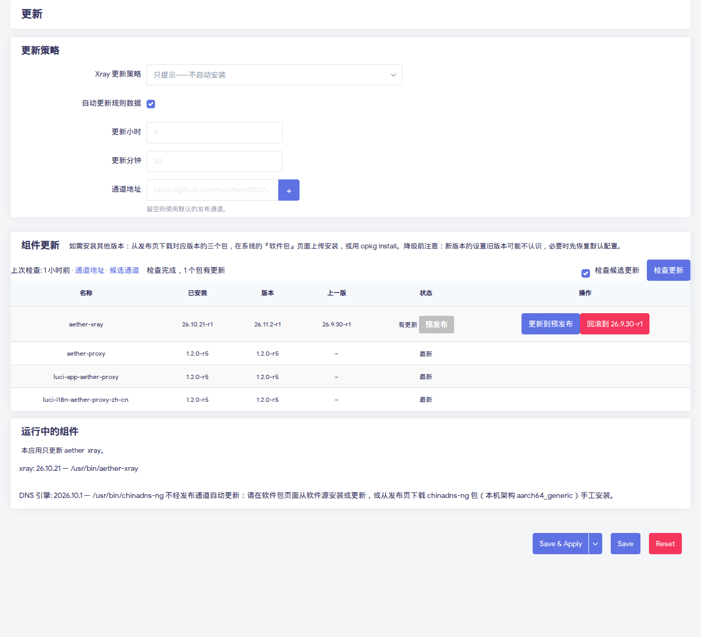

# T16.33 更新页：开关不触发检查、文案与状态行收拢

工作树：`/workspace/openwrt/aether-proxy-wt/T16.33`；分支：`feat/t16.33-update-polish`；基线：`4f2ebea`。

- 「检查候选更新」只保存通道偏好并重画已有结果，不派发检查作业，不覆盖其他未保存的表单输入。没有检查结果时仍显示「尚未检查」；手动点击「检查更新」才启动检查。
- 时间、通道链接、进度、结果与错误共用状态行。链接显示短标签，悬停可查看完整 URL；仅在候选模式且有候选地址时显示「候选通道」。表格、安装和回滚流程不变。

## 场景对照

- **拨动开关不发作业**：`tests/luci/updates.test.js` → `T16.33 switching candidate mode starts no update_check job and preserves form edits`。启用和关闭前后分别比对 `ap.run_job` 调用计数；同时验证缓存复用、UCI 重读、未保存输入和 RC 安装确认。
- 同一断言校验两个链接的 `href`、`target`、`rel`、`title`，关闭候选后不再渲染「候选通道」。`T16.33 last checked, progress, summary and errors share the status row` 验证时间、结果、进度与错误位置及 `role="status"`。另覆盖初次读取、尚未检查和偏好提交失败时恢复控件。
- Chromium 预览额外统计 `job_start`：打开候选后为 0，手动检查后为 1，关闭候选后仍为 1；360 px 下两种主题的链接均与检查时间同一视觉行，不单独占行。

`bash tests/luci/run.sh`：1172 通过、0 失败；未引用翻译 0。

## 截图

均为 Chromium 下的真实 LuCI SDK 与主题，UCI / rpcd 使用离线夹具。改前引用基线中已入库的 T16.31 截图；改前、改后均为候选模式下已完成检查。未操作真实路由器。

| 主题 / 宽度 | 改前（基线） | 改后 |
|---|---|---|
| Bootstrap 深色 / 360 px |  |  |
| Bootstrap 深色 / 1320 px |  |  |
| Argon Plus 浅色 / 360 px |  |  |
| Argon Plus 浅色 / 1320 px |  |  |

复现：设置 `NODE_PATH` 为 Playwright 的 `node_modules`，`WWW` 为包含两套主题的 OpenWrt 构建产物的 `www` 目录。

```sh
AETHER_T16_33=1 AETHER_PREVIEW_VIEW=updates node tests/luci/t16.24-theme-preview.js \
  "$WWW" tests/luci/evidence/t16.33
```
