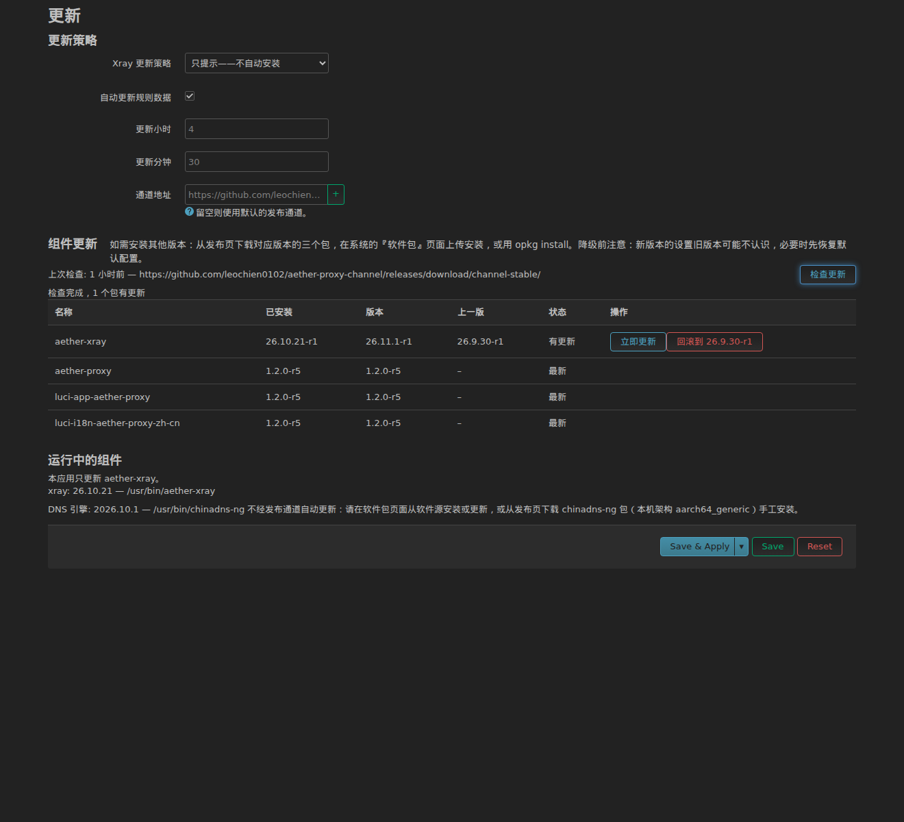
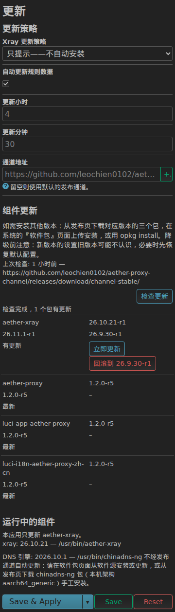
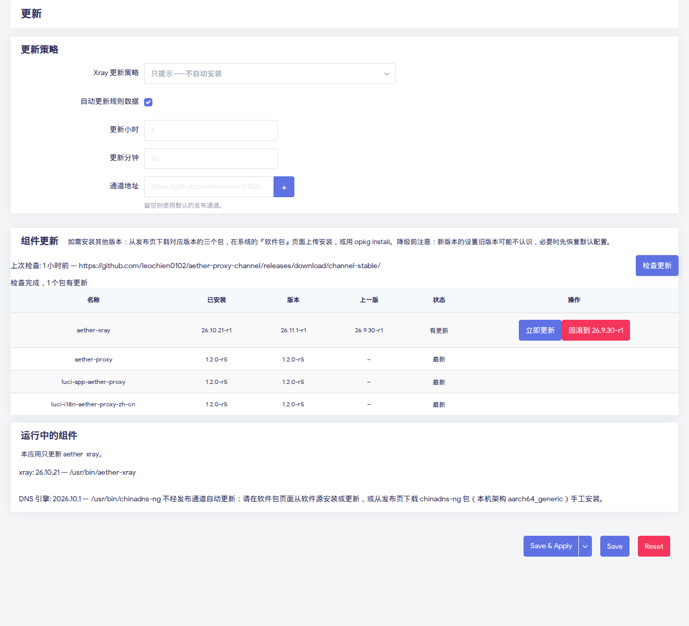
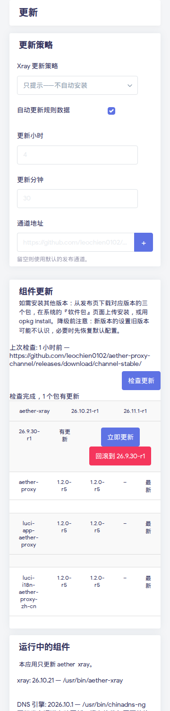

# T16.34 客户端只读正式通道

分支 `feat/t16.34-remove-rc`，基线 `ecb5983`。客户端只使用 `channel-stable` 或配置的正式通道镜像。清单验签、安装、兼容链和回滚代码恢复至 `v1.2.1-r1`；保留更新页已有布局、进度反馈和手动安装说明。未改发版工具、channel 仓或清单格式。

## 三项核对

| 核对 | 结果与环境 |
|---|---|
| `uci show aetherproxy \| grep -c update_channel` | **0**。用真实 host `uci` 在隔离配置目录读取包随附配置。已有设备上的遗留键会被忽略，不迁移或改写用户配置；若文件曾写入该键，`uci show` 仍会列出它。 |
| `ubus -v list aetherproxy` | 私有 socket 上的原生 `ubusd` / `rpcd` 加载本分支的实际插件，成功列出 **26** 个方法（含 `job_start`），没有 `set_update_channel`。`tests/rpcd/test.uc` 另断言导出表不含该方法，并拒绝带 `--channel` 的安装任务。 |
| `aether-proxy update check --json` | `tests/update/run.sh` 用真实 usign 签名和本地 HTTP 夹具验证。即使 UCI 留有 `update_channel=rc`、旧缓存有 `release_candidates`，HTTP 日志也只有 **一次清单请求**（`GET /channel-stable/manifest.json`，另取签名），返回正式版本 `26.10.10-r1`；CLI JSON 与重写后的 `updates.json` 相同，均不含 `release_candidates`。 |

这些检查均在本地隔离环境进行，未操作路由器。CLI 的 `update package … --channel stable` 返回退出码 2 和 JSON `USAGE`。

## 回归

任务指定的 16 套均退出 0（unit 用 `tests/host/ucode tests/run.uc`，其余用 `bash tests/<suite>/run.sh`，procd 位于 `tests/stubs/procd/`）。

| 套件 | 通过 | 套件 | 通过 |
|---|---:|---|---:|
| unit | 1441 | procd | 123 |
| cli | 221 | sub-status | 10 |
| stats | 113 条 PASS | sub | 157 |
| status | 204 | job | 104 |
| node | 192 | rpcd | 463 |
| daemon | 326 | probe | 43 |
| monitor | 801 条 PASS | luci | 1170 |
| reload | 231 | schedule | 47 |

额外套件：update **1038**、rules **7**、compat **10**，均为 0 failed。LuCI 翻译检查输出 `Unused msgids: 0`。删除旧候选用例后，update / rpcd / luci 分别由 1068 / 476 / 1171 降至 1038 / 463 / 1170。

`git diff --check` 无输出。分支审查命令：`CI_TOOLS_DIR=/workspace/openwrt/ci-spike/tools bash tests/review.sh main`。`docs/05-config.md`、`docs/08-updates.md`、`docs/10-cli-luci.md` 按本卡白名单同步，属于审查脚本预期的 `docs/ changed` 警告。

## 更新页截图

使用构建产物中的真实 LuCI SDK/主题和 Chromium；UCI / rpcd 为离线夹具。图中已完成正式通道检查，状态行仅保留「检查更新」，没有候选开关和徽标。预览脚本也断言检查进行中禁用按钮、完成后重新启用，以及 360 px 工具栏不溢出。

| 主题 | 桌面（1320 px） | 窄屏（360 px） |
|---|---|---|
| Bootstrap 深色 |  |  |
| Argon Plus 浅色 |  |  |

复现（`NODE_PATH` 指向 Playwright，`WWW` 指向构建产物的 `www`）：

```sh
AETHER_PREVIEW_VIEW=updates node tests/luci/t16.24-theme-preview.js "$WWW" tests/luci/evidence/t16.34
```
