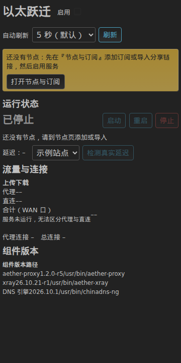
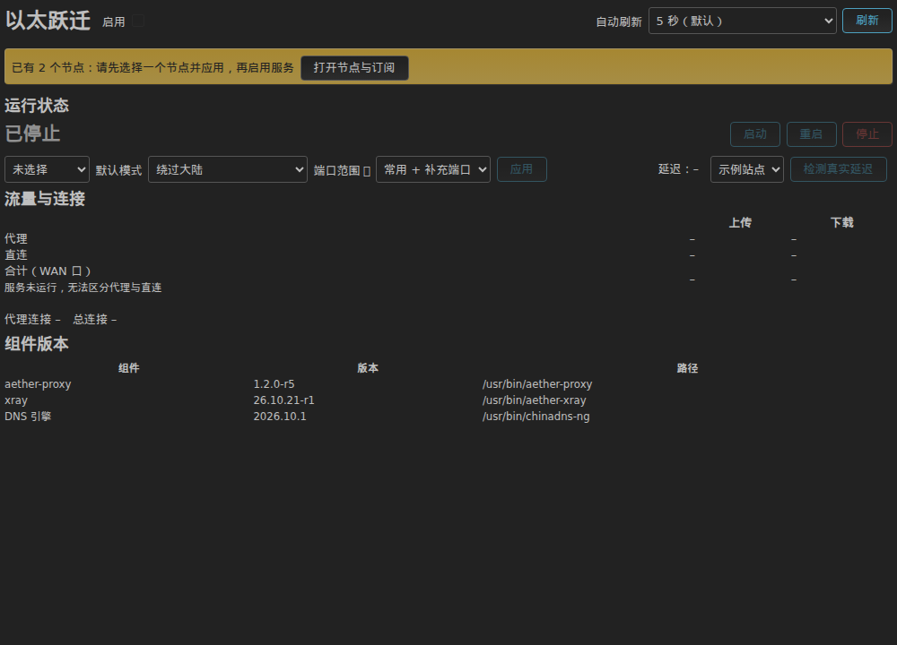
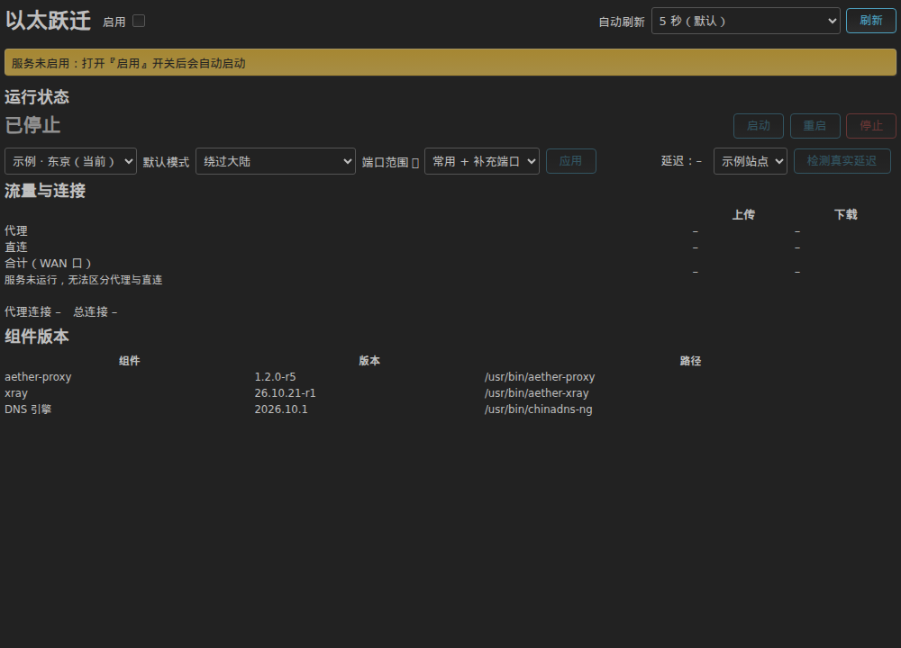

# T16.44 概览页「启用」提示按节点状态分档

工作树 `aether-proxy-wt/T16.44`，分支 `feat/t16.44-enable-hint`，基线 `0b896eb0`。状态读取中、读取失败及读取成功均使用同一 `disabled_notice`：已启用为 `null`，未启用为 `{ text, action }`。缺节点或未应用节点时，禁用开关的悬停文字取自同一提示，横幅附节点页链接。开关可用性表达式、后端、节点/订阅页、版本号和 Makefile 不变。

## 三档预览

离线 Chromium 使用构建产物中的 LuCI SDK / Bootstrap 暗色主题、当前分支的 LuCI 源码与中文 PO；UCI/RPC 为固定数据，未连接真机。三档服务均处于「已停止」、`main.enabled=0`。浏览器断言检查了开关状态、横幅、悬停与链接；前两档均验证链接在 1000 px 同排、360 px 换行。

### 无节点（360 px）



### 有节点未选（1000 px）



### 已选节点、服务未启用（1000 px）



## DOM 片段

摘自 Chromium `outerHTML`，仅为可读性调整换行：

```html
<!-- 无节点 -->
<div class="alert-message warning" style="display:flex; align-items:center; gap:0.5em; flex-wrap:wrap">
  <span>还没有节点：先在『节点与订阅』添加订阅或导入分享链接，然后启用服务</span>
  <a href="/cgi-bin/luci/admin/services/aether-proxy/nodes" class="cbi-button cbi-button-link">打开节点与订阅</a>
</div>
<!-- 有节点未选 -->
<div class="alert-message warning" style="display:flex; align-items:center; gap:0.5em; flex-wrap:wrap">
  <span>已有 2 个节点：请先选择一个节点并应用，再启用服务</span>
  <a href="/cgi-bin/luci/admin/services/aether-proxy/nodes" class="cbi-button cbi-button-link">打开节点与订阅</a>
</div>
<!-- 已选节点、服务未启用 -->
<div class="alert-message warning" style="display:flex; align-items:center; gap:0.5em; flex-wrap:wrap">
  <span>服务未启用：打开『启用』开关后会自动启动</span>
</div>
```

## PO 增量

三档提示中前两档为新条目，第三档沿用已有条目；另新增链接标签，删除已无引用的旧悬停文案。全部条目使用 `aether-proxy` 上下文。

| 变更 | msgid | zh_Hans |
|---|---|---|
| 新增 | `No nodes yet: add a subscription or import share links under Nodes & subscriptions, then enable the service.` | 还没有节点：先在『节点与订阅』添加订阅或导入分享链接，然后启用服务 |
| 新增 | `%s node(s) available: choose one and apply before enabling the service.` | 已有 %s 个节点：请先选择一个节点并应用，再启用服务 |
| 保留 | `The service is not enabled: turn on the Enable switch and it will start automatically.` | 服务未启用：打开『启用』开关后会自动启动 |
| 新增 | `Open Nodes & subscriptions` | 打开节点与订阅 |
| 删除 | `Please select a node and apply first.` | 请先选择节点并应用。 |

## 验收

- `bash tests/luci/run.sh`：`1179 passed, 0 failed`。Node TAP 为 1152 通过、0 失败；6 个依赖特定本地 SDK 路径的既有可选用例跳过。新增 8 项模型/视图检查全过，覆盖三档及已启用无横幅。PO 未引用条目为 **0**。
- `bash tests/host/ucode tests/run.uc`：`1444 passed, 0 failed, 0 skipped`。
- `git diff --check` 与 `git diff --check main...HEAD`：无输出。
- `CI_TOOLS_DIR=/workspace/openwrt/ci-spike/tools bash tests/review.sh main`：**0 FAIL / 1 WARN**。CLI 222 通过，真实 Xray 26.11.9 检查 26 项、0 失败。唯一警告是任务卡要求修改的 `docs/10-cli-luci.md`。
